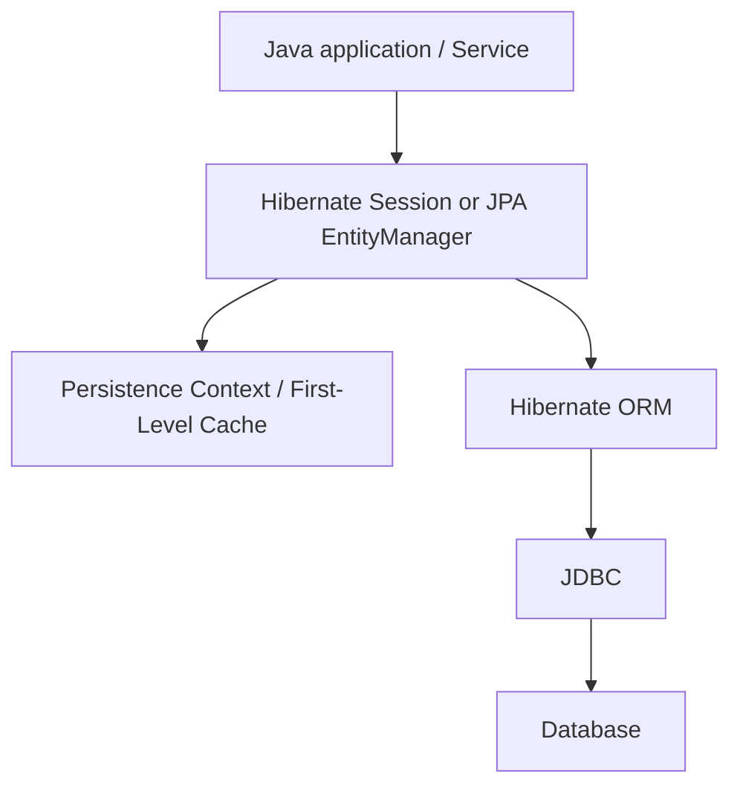
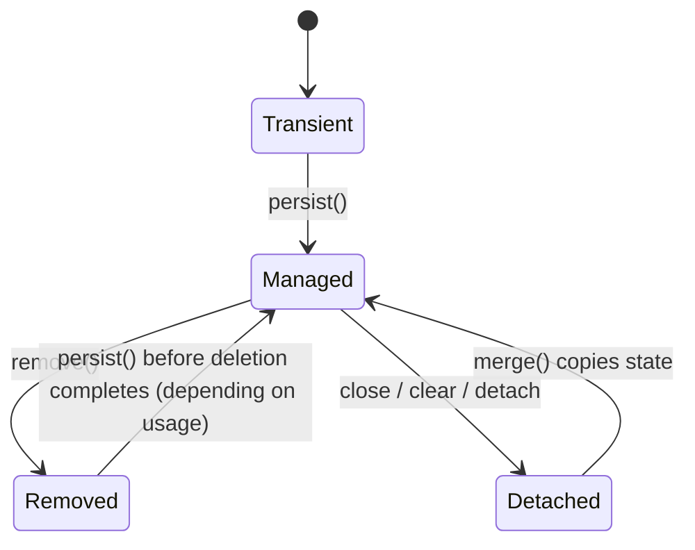

# Hibernate ORM — Practical Guide for Java Developers

> **Guide target:** Java 21/25, PostgreSQL, Maven, Hibernate ORM 8 API examples (development release as of 26 Nov 2026), and maintainable application design.
>
> **Version note:** Hibernate ORM 8.0.0.CR2 is a development/candidate release, not a final stable release. The current stable Hibernate series as of this guide's date is 7.4.17.Final. Use Hibernate 8 for learning/testing if you intentionally want to explore it; prefer the latest supported stable release for production, and check the official compatibility and migration docs before upgrading.

---

## Contents

1. What Hibernate is
2. ORM fundamentals and architecture
3. Setup with Maven and PostgreSQL
4. Configure Hibernate in IntelliJ IDEA, Eclipse and VS Code
5. Configuration: `hibernate.cfg.xml`
6. Bootstrap, lifecycle and APIs
7. Entity mappings
8. Table/entity/column naming and schema changes
9. CRUD: maintainable patterns
10. Relationships and joins
11. HQL/JPQL, Criteria, native SQL, pagination
12. Create a database
13. Transactions, persistence context and dirty checking
14. Performance and fetching
15. Schema migrations and long-term maintenance
16. Errors and troubleshooting
17. Project structure
18. Production recommendations
19. Glossary
20. Official references

---

# 1. What is Hibernate?

Hibernate ORM is a Java Object/Relational Mapping (ORM) framework. It maps Java objects to relational database records and helps manage persistence, queries, transactions, object relationships, and synchronization between in-memory state and database state.

Without an ORM, application code commonly needs to:
- Write SQL for each operation.
- Bind values to JDBC statements.
- Read result sets and manually create Java objects.
- Track updates and persist them.
- Handle repetitive resource and transaction code.

Hibernate automates much of that work while still allowing SQL when needed.

### 1.1 ORM example

| Java | Relational database |
|---|---|
| `Alien` class | `alien` table |
| `Alien.id` field | `a_id` column |
| `new Alien()` | In-memory object |
| `session.persist(alien)` | INSERT is scheduled |
| `session.find(Alien.class, 1)` | SELECT by primary key |
| Change a managed field | Hibernate detects change and UPDATEs at flush |

### 1.2 Benefits

- Less repetitive JDBC code.
- Object-oriented domain model.
- Entity relationship mapping.
- Transaction and persistence-context management.
- HQL/JPQL and Criteria queries.
- Dirty checking.
- Lazy/eager fetching controls.
- Caching options.
- Database portability (within the limits of dialects, SQL, and vendor features).

### 1.3 ORM is not a replacement for SQL knowledge

You should still understand:
- Tables, keys, indexes and constraints.
- Joins, subqueries, grouping and query plans.
- Transactions and isolation.
- Database migrations.
- Performance and locking.

Hibernate generates SQL; it doesn't guarantee that the SQL will be optimal.

---

# 2. ORM fundamentals and architecture

## 2.1 Architecture



## 2.2 Core objects

| API / concept | Purpose | Lifetime |
|---|---|---|
| `SessionFactory` | Hibernate's factory for Sessions; also holds configuration and metadata | Usually once per application |
| `Session` | Hibernate-native unit of work; manages entities and persistence context | Short-lived, per unit of work |
| `EntityManagerFactory` | JPA-standard factory; Hibernate implements it | Usually once per application |
| `EntityManager` | JPA-standard persistence context/unit of work | Short-lived |
| `Transaction` | Native Hibernate transaction control | Per transaction |
| `EntityTransaction` | JPA transaction API in resource-local setup | Per transaction |
| Persistence context | Tracks managed entity instances and their state | Associated with a Session/EntityManager |
| JDBC connection | Database connection | Managed by provider/pool |

## 2.3 Entity lifecycle states



- **Transient/new:** Java object exists, but is not managed by Hibernate.
- **Managed/persistent:** tracked by the current persistence context.
- **Detached:** was managed, but is no longer attached to that context.
- **Removed:** managed entity marked for deletion.

## 2.4 Persistence context and first-level cache

A persistence context ensures that within a context, Hibernate maintains identity for a managed entity key.

```java
Alien first = session.find(Alien.class, 1);
Alien second = session.find(Alien.class, 1);

System.out.println(first == second); // usually true in the same persistence context
```

The second lookup can be served from the persistence context without another SELECT.

---

# 3. Setup with Maven and PostgreSQL

## 3.1 Prerequisites

- Java 21 or 25 (check Hibernate version compatibility).
- Maven.
- PostgreSQL server.
- IDE: IntelliJ IDEA, Eclipse or VS Code.

Check Java and Maven:

```bash
java -version
mvn -version
```

## 3.2 Create a Maven project

Example structure:

```text
HibernateDemo/
├── pom.xml
└── src/
    └── main/
        ├── java/
        │   └── com/ashwinkumard/
        │       ├── Main.java
        │       ├── Alien.java
        │       └── HibernateUtil.java
        └── resources/
            └── hibernate.cfg.xml
```

## 3.3 Maven dependencies

For Hibernate ORM 8.0.0.CR2 learning:

```xml
<properties>
    <maven.compiler.release>25</maven.compiler.release>
    <project.build.sourceEncoding>UTF-8</project.build.sourceEncoding>
    <hibernate.version>8.0.0.CR2</hibernate.version>
</properties>

<dependencies>
    <dependency>
        <groupId>org.hibernate.orm</groupId>
        <artifactId>hibernate-core</artifactId>
        <version>${hibernate.version}</version>
    </dependency>

    <dependency>
        <groupId>org.postgresql</groupId>
        <artifactId>postgresql</artifactId>
        <version>42.7.15</version>
    </dependency>

    <!-- Optional: logging implementation for Hibernate/JBoss Logging -->
    <dependency>
        <groupId>ch.qos.logback</groupId>
        <artifactId>logback-classic</artifactId>
        <version>1.5.21</version>
    </dependency>
</dependencies>
```

> Adjust the Java compiler release to the JDK you actually use. Hibernate ORM 8's compatibility list currently includes Java 17, 21, 25 and 27. Avoid mixing incompatible Hibernate and Jakarta Persistence versions manually; let Hibernate's dependency metadata manage its required API versions.

## 3.4 PostgreSQL database and user

Run these statements in `psql`, pgAdmin or a PostgreSQL administration tool while connected to an administrative database (such as `postgres`):

```sql
CREATE USER hibernate_user WITH PASSWORD 'change_this_password';
CREATE DATABASE db_hibernate OWNER hibernate_user;
```

If your database server requires a different role/database workflow, follow your PostgreSQL administrator's setup.

Connect to the new database:

```bash
psql -h localhost -p 5432 -U hibernate_user -d db_hibernate
```

---

# 4. Configure Hibernate in IntelliJ IDEA, Eclipse and VS Code

Hibernate is a Maven library, not an IDE-specific framework. The core configuration is the same in all three IDEs.

## 4.1 IntelliJ IDEA

1. Create a new **Java** project.
2. Select **Maven** as the build system.
3. Select a JDK (21 or 25, as compatible).
4. Add dependencies in `pom.xml`.
5. Create packages and entity classes in `src/main/java`.
6. Put `hibernate.cfg.xml` in `src/main/resources`.
7. Reload Maven: open Maven tool window and click Reload, or right-click `pom.xml` → Maven → Reload Project.
8. Create a PostgreSQL connection in Database tool window if available; this is optional for Hibernate execution but useful for inspecting schema and data.
9. Run `Main.java`.

## 4.2 Eclipse

1. Install/use Eclipse IDE for Java Developers.
2. Create **Maven → Maven Project**.
3. Choose archetype or create a simple project.
4. Add Hibernate and PostgreSQL dependencies to `pom.xml`.
5. Save and use **Maven → Update Project**.
6. Create entity classes under `src/main/java`.
7. Create `hibernate.cfg.xml` under `src/main/resources`.
8. Run the class with the `main()` method.
9. Use Database Development tools (if installed) to connect to PostgreSQL.

## 4.3 Visual Studio Code

1. Install VS Code.
2. Install **Extension Pack for Java** (including Java language support and Maven support).
3. Install a PostgreSQL extension if you want database browsing; extension choice is optional.
4. Open the Maven project folder.
5. Add dependencies to `pom.xml`.
6. Allow Java/Maven project import to complete.
7. Create source files and resource configuration.
8. Run `Main.java` using the Java Run action.

## 4.4 IDE troubleshooting

- If imports are red: reload Maven and confirm dependency downloads.
- If Maven uses a different JDK: configure Maven runner/toolchain and project SDK.
- If the config file isn't found: verify it is under `src/main/resources`.
- If the database connection fails: verify PostgreSQL is running, port, database, username and password.
- If Hibernate can't find an entity: register it or configure entity scanning appropriately.

---

# 5. Hibernate configuration: `hibernate.cfg.xml`

Create `src/main/resources/hibernate.cfg.xml`:

```xml
<?xml version="1.0" encoding="UTF-8"?>
<!DOCTYPE hibernate-configuration PUBLIC
        "-//Hibernate/Hibernate Configuration DTD 3.0//EN"
        "https://hibernate.org/dtd/hibernate-configuration-3.0.dtd">

<hibernate-configuration>
    <session-factory>

        <property name="hibernate.connection.driver_class">
            org.postgresql.Driver
        </property>

        <property name="hibernate.connection.url">
            jdbc:postgresql://localhost:5432/db_hibernate
        </property>

        <property name="hibernate.connection.username">
            hibernate_user
        </property>

        <property name="hibernate.connection.password">
            change_this_password
        </property>

        <!-- For learning only: validate/update/create/create-drop/none -->
        <property name="hibernate.hbm2ddl.auto">update</property>

        <!-- Helpful during learning; disable or tune in production -->
        <property name="hibernate.show_sql">true</property>
        <property name="hibernate.format_sql">true</property>

        <!-- Optional: use JDBC batching where applicable -->
        <property name="hibernate.jdbc.batch_size">50</property>

        <mapping class="com.ashwinkumard.Alien"/>
        <mapping class="com.ashwinkumard.Department"/>
        <mapping class="com.ashwinkumard.Employee"/>

    </session-factory>
</hibernate-configuration>
```

> Only include mappings for classes that exist. Alternatively, register classes programmatically with `Configuration.addAnnotatedClass(...)` and remove the corresponding `<mapping>` entries.

## 5.1 `hibernate.hbm2ddl.auto` options

| Value | Behavior | Recommendation |
|---|---|---|
| `none` | No automatic schema action | Production with migrations, if configured |
| `validate` | Checks schema against mappings; doesn't modify schema | Good production startup check |
| `update` | Attempts to adjust schema to mapping | Learning/dev only; not a migration system |
| `create` | Creates mapped schema, generally dropping/recreating existing mapped objects | Disposable environment only |
| `create-drop` | Creates schema and drops it when SessionFactory closes | Tests/disposable environment only |

Schema-update behavior varies by change. It is not a reliable mechanism for renaming columns, changing data safely, or performing complex migrations.

---

# 6. Bootstrap and API usage

## 6.1 Common bootstrap approach

Create `HibernateUtil.java`:

```java
package com.ashwinkumard;

import org.hibernate.SessionFactory;
import org.hibernate.cfg.Configuration;

public final class HibernateUtil {

    private static final SessionFactory SESSION_FACTORY =
            new Configuration()
                    .configure("hibernate.cfg.xml")
                    .buildSessionFactory();

    private HibernateUtil() {
    }

    public static SessionFactory getSessionFactory() {
        return SESSION_FACTORY;
    }

    public static void shutdown() {
        SESSION_FACTORY.close();
    }
}
```

If you prefer explicit class registration:

```java
SessionFactory factory = new Configuration()
        .addAnnotatedClass(Alien.class)
        .configure("hibernate.cfg.xml")
        .buildSessionFactory();
```

Don't register the same mapping in conflicting ways. Pick a consistent approach.

## 6.2 API table

| API | Usage | Example |
|---|---|---|
| `SessionFactory` | Create Sessions | `factory.openSession()` |
| `Session` | Persistence context/unit of work | `session.find(...)` |
| `Transaction` | Transaction control | `session.beginTransaction()` |
| `persist()` | Make new entity managed | `session.persist(entity)` |
| `find()` | Retrieve by primary key | `session.find(Alien.class, 1)` |
| `getReference()` | Obtain reference/proxy | `session.getReference(Alien.class, 1)` |
| `merge()` | Copy detached state into managed instance | `session.merge(detached)` |
| `remove()` | Mark managed entity for deletion | `session.remove(entity)` |
| `refresh()` | Reload state from database | `session.refresh(entity)` |
| `flush()` | Synchronize pending changes to DB | `session.flush()` |
| `clear()` | Detach all managed entities | `session.clear()` |
| `detach()` | Detach a specific entity | `session.detach(entity)` |
| `contains()` | Check whether entity is managed | `session.contains(entity)` |
| `getTransaction()` | Get transaction API | `session.getTransaction()` |
| `createQuery()` | HQL/JPQL query | `session.createQuery(...)` |
| `createNativeQuery()` | Native SQL query | `session.createNativeQuery(...)` |
| `createMutationQuery()` | HQL UPDATE/DELETE query in supported versions | `session.createMutationQuery(...)` |

## 6.3 `find()`

```java
Alien alien = session.find(Alien.class, 1);
```

- Finds by primary key.
- Returns entity or `null`.
- Can use the persistence context/second-level cache where applicable.

## 6.4 `getReference()`

```java
Alien alien = session.getReference(Alien.class, 1);
```

- Can return a proxy/reference without immediately fetching all state.
- Accessing a non-identifier property can trigger initialization.
- If the row is absent, failure may occur when the proxy is initialized.
- A proxy requiring initialization cannot normally be used after its Session is closed.

## 6.5 `persist()`

```java
session.persist(newAlien);
```

- Used for new entities.
- Entity becomes managed.
- SQL may be executed at flush/commit, depending on ID generation and provider behavior.

## 6.6 `merge()`

```java
Alien managedCopy = session.merge(detachedAlien);
```

- Copies detached object's state to a managed instance.
- The returned object is the managed copy.
- The original detached instance is not necessarily managed.
- It is not a simple unconditional UPDATE; database and entity state determine behavior.

## 6.7 `remove()`

```java
session.remove(managedAlien);
```

- The entity must be managed (or otherwise supported by the API's semantics).
- Marks it for deletion.
- SQL is usually emitted at flush/commit.

## 6.8 `refresh()`

```java
session.refresh(alien);
```

Reloads the entity's state from the database, discarding local state changes to that entity.

## 6.9 `flush()`

```java
session.flush();
```

Synchronizes pending persistence-context changes with the database. Flush is not the same as commit: the transaction may still be rolled back.

## 6.10 `clear()` and `detach()`

```java
session.detach(alien); // detach one object
session.clear();       // detach all managed objects
```

Useful for memory management in large batch workloads, but changes made to detached objects aren't automatically persisted.

## 6.11 `contains()`

```java
boolean managed = session.contains(alien);
```

Checks whether the object is currently managed by that Session.

---

# 7. Entity mappings

## 7.1 Basic entity

```java
package com.ashwinkumard;

import jakarta.persistence.*;

@Entity
@Table(name = "alien")
public class Alien {

    @Id
    @Column(name = "a_id")
    private Integer id;

    @Column(name = "a_name", nullable = false, length = 100)
    private String name;

    @Column(name = "tech", length = 100)
    private String tech;

    protected Alien() { // required by JPA entity rules
    }

    public Alien(Integer id, String name, String tech) {
        this.id = id;
        this.name = name;
        this.tech = tech;
    }

    public Integer getId() {
        return id;
    }

    public void setId(Integer id) {
        this.id = id;
    }

    public String getName() {
        return name;
    }

    public void setName(String name) {
        this.name = name;
    }

    public String getTech() {
        return tech;
    }

    public void setTech(String tech) {
        this.tech = tech;
    }

    @Override
    public String toString() {
        return "Alien{id=" + id + ", name='" + name + "', tech='" + tech + "'}";
    }
}
```

> Prefer a protected or public no-argument constructor. Entities should generally not be final and should not have final persistent fields if proxying/enhancement and provider portability matter.

## 7.2 Primary key generation

Assigned ID:

```java
@Id
private Integer id;
```

Generated ID:

```java
@Id
@GeneratedValue(strategy = GenerationType.IDENTITY)
private Long id;
```

Alternative strategy for databases supporting sequences:

```java
@Id
@GeneratedValue(strategy = GenerationType.SEQUENCE, generator = "alien_seq")
@SequenceGenerator(name = "alien_seq", sequenceName = "alien_seq", allocationSize = 50)
private Long id;
```

Use generated IDs for most new entities unless the application has a meaningful externally assigned key. Choose a strategy based on database, throughput, and migration needs.

## 7.3 Unique, nullable, length and check constraints

```java
@Entity
@Table(
    name = "employee",
    uniqueConstraints = @UniqueConstraint(name = "uk_employee_email", columnNames = "email"),
    indexes = @Index(name = "idx_employee_name", columnList = "name")
)
public class Employee {
    @Id
    @GeneratedValue(strategy = GenerationType.IDENTITY)
    private Long id;

    @Column(nullable = false, unique = true, length = 200)
    private String email;
}
```

> These annotations describe schema metadata; production constraints should be created and maintained with migration scripts.

## 7.4 Embeddable value type

```java
@Embeddable
public class Address {
    private String street;
    private String city;
    private String postalCode;
}
```

```java
@Entity
public class Customer {
    @Id
    @GeneratedValue(strategy = GenerationType.IDENTITY)
    private Long id;

    @Embedded
    private Address address;
}
```

An embedded object generally maps its fields to columns in the owning entity's table.

---

# 8. Entity/table/column naming and schema changes

**Important:** Entity mappings and physical database schema are separate. Annotation changes don't guarantee that existing database objects will be safely renamed or migrated.

## 8.1 Rename physical table while keeping Java class name

Java class stays `Alien`. Rename table mapping to `alien_data`:

```java
@Entity
@Table(name = "alien_data")
public class Alien {
    @Id
    private Integer id;
}
```

`@Entity(name = "Alien")` or `@Entity(name = "alien")` defines the entity name used in entity queries, not the physical table name. `@Table(name = "...")` controls table mapping.

Migration SQL (if the existing table is `alien`):

```sql
ALTER TABLE public.alien RENAME TO alien_data;
```

If you choose `@Entity(name = "alien")`, HQL/JPQL may use that entity name; the physical table is still determined by `@Table`.

## 8.2 Rename a column without renaming Java property

Java field remains `id`, database column becomes `a_id`:

```java
@Id
@Column(name = "a_id")
private Integer id;
```

Migration:

```sql
ALTER TABLE public.alien RENAME COLUMN id TO a_id;
```

Java continues to use `id`; Hibernate uses `a_id` in SQL.

## 8.3 Rename both Java property and physical column

Java field renamed to `alienId`; database column `a_id`:

```java
@Id
@Column(name = "a_id")
private Integer alienId;
```

The database migration still renames the column if it previously was `id`:

```sql
ALTER TABLE public.alien RENAME COLUMN id TO a_id;
```

Renaming the Java field is a code refactoring; renaming the database column is a database migration. They are separate tasks.

## 8.4 Rename a Java property but keep the database column name

Java field `alienId`, database column `id`:

```java
@Id
@Column(name = "id")
private Integer alienId;
```

No database change is required if the table already has `id`.

## 8.5 Add a new entity property and column

Java:

```java
@Column(name = "email")
private String email;
```

Migration:

```sql
ALTER TABLE public.alien ADD COLUMN email varchar(255);
```

For a required column on a populated table, use a staged migration:

```sql
ALTER TABLE public.alien ADD COLUMN email varchar(255);
UPDATE public.alien SET email = 'unknown@example.com' WHERE email IS NULL;
ALTER TABLE public.alien ALTER COLUMN email SET NOT NULL;
```

> Do not use a generic placeholder for real data without considering uniqueness, business rules and data correctness.

## 8.6 Delete a column

Remove the property from the entity and create a migration:

```sql
ALTER TABLE public.alien DROP COLUMN old_column;
```

Dropping a column permanently removes its stored values. Back up data and review dependencies first.

## 8.7 Change column type

Entity:

```java
@Column(name = "age")
private Integer age;
```

Example migration (only if the data is compatible):

```sql
ALTER TABLE public.alien
ALTER COLUMN age TYPE integer
USING age::integer;
```

Always check for invalid values and compatibility before conversion.

## 8.8 Change nullability

Mapping:

```java
@Column(name = "a_name", nullable = false)
private String name;
```

Migration:

```sql
UPDATE public.alien SET a_name = 'Unknown' WHERE a_name IS NULL;
ALTER TABLE public.alien ALTER COLUMN a_name SET NOT NULL;
```

To allow null:

```sql
ALTER TABLE public.alien ALTER COLUMN a_name DROP NOT NULL;
```

## 8.9 Rename a schema

Mapping:

```java
@Table(name = "alien", schema = "hr")
```

Migration:

```sql
CREATE SCHEMA IF NOT EXISTS hr;
ALTER TABLE public.alien SET SCHEMA hr;
```

Configure database permissions and schema search paths appropriately.

## 8.10 Rename a database

PostgreSQL example (connect to another database, such as `postgres`; ensure no active sessions):

```sql
ALTER DATABASE db_hibernate RENAME TO db_hibernate_new;
```

Update the JDBC URL accordingly:

```xml
<property name="hibernate.connection.url">
    jdbc:postgresql://localhost:5432/db_hibernate_new
</property>
```

## 8.11 Rename a constraint

```sql
ALTER TABLE public.alien
RENAME CONSTRAINT alien_pkey TO pk_alien;
```

## 8.12 Add/remove unique constraint

```sql
ALTER TABLE public.alien ADD CONSTRAINT uk_alien_name UNIQUE (a_name);
```

```sql
ALTER TABLE public.alien DROP CONSTRAINT uk_alien_name;
```

Check duplicates before adding a unique constraint.

## 8.13 Add/remove index

```sql
CREATE INDEX idx_alien_tech ON public.alien (tech);
```

```sql
DROP INDEX IF EXISTS public.idx_alien_tech;
```

Index columns used in common filtering, joining and ordering patterns, after examining query plans. Avoid indiscriminate indexes.

## 8.14 Add/remove foreign key

```sql
ALTER TABLE public.employee
ADD CONSTRAINT fk_employee_department
FOREIGN KEY (department_id) REFERENCES public.department(id);
```

```sql
ALTER TABLE public.employee DROP CONSTRAINT fk_employee_department;
```

## 8.15 Add a default value

```sql
ALTER TABLE public.alien
ALTER COLUMN status SET DEFAULT 'ACTIVE';
```

Remove default:

```sql
ALTER TABLE public.alien
ALTER COLUMN status DROP DEFAULT;
```

A database default does not necessarily mean that the Java entity field is populated in memory before insert. Consider application-level defaults too.

## 8.16 Add a check constraint

```sql
ALTER TABLE public.employee
ADD CONSTRAINT ck_employee_salary_positive CHECK (salary >= 0);
```

## 8.17 Table partitioning

Partitioning is a database design decision; Hibernate mapping alone does not create an appropriate partitioning strategy.

Example PostgreSQL range partitioning by date (illustrative):

```sql
CREATE TABLE event_log (
    id bigint NOT NULL,
    created_at date NOT NULL,
    message text
) PARTITION BY RANGE (created_at);

CREATE TABLE event_log_2026
PARTITION OF event_log
FOR VALUES FROM ('2026-01-01') TO ('2027-01-01');
```

For partitioning, evaluate data volume, partition key, indexes, constraints, query patterns and operational maintenance.

## 8.18 Move from one table design to another safely

A long-term migration can use an expand/contract process:

1. Add the new column/table (don't remove old data yet).
2. Deploy code that can read old and new structures, if necessary.
3. Backfill data.
4. Validate data.
5. Switch reads/writes.
6. Deploy code that no longer uses the old structure.
7. Remove old columns/table in a later migration.

This reduces downtime and avoids making one deployment depend on a risky destructive change.

---

# 9. CRUD operations: maintainable code

## 9.1 Recommended standalone pattern

For a small learning application, use a single `SessionFactory`, a Session per operation, and transactions around writes.

```java
package com.ashwinkumard;

import org.hibernate.Session;
import org.hibernate.Transaction;

public class AlienDao {

    public void create(Alien alien) {
        try (Session session = HibernateUtil.getSessionFactory().openSession()) {
            Transaction tx = session.beginTransaction();
            try {
                session.persist(alien);
                tx.commit();
            } catch (RuntimeException ex) {
                if (tx.isActive()) tx.rollback();
                throw ex;
            }
        }
    }

    public Alien findById(Integer id) {
        try (Session session = HibernateUtil.getSessionFactory().openSession()) {
            return session.find(Alien.class, id);
        }
    }

    public void update(Integer id, String name, String tech) {
        try (Session session = HibernateUtil.getSessionFactory().openSession()) {
            Transaction tx = session.beginTransaction();
            try {
                Alien alien = session.find(Alien.class, id);
                if (alien == null) {
                    throw new IllegalArgumentException("Alien not found: " + id);
                }

                alien.setName(name);
                alien.setTech(tech);
                // Managed entity: dirty checking; no update() call needed.

                tx.commit();
            } catch (RuntimeException ex) {
                if (tx.isActive()) tx.rollback();
                throw ex;
            }
        }
    }

    public void delete(Integer id) {
        try (Session session = HibernateUtil.getSessionFactory().openSession()) {
            Transaction tx = session.beginTransaction();
            try {
                Alien alien = session.find(Alien.class, id);
                if (alien != null) {
                    session.remove(alien);
                }
                tx.commit();
            } catch (RuntimeException ex) {
                if (tx.isActive()) tx.rollback();
                throw ex;
            }
        }
    }
}
```

> For a real large application, prefer a service layer with transaction boundaries, a DAO/repository layer (or Spring Data JPA), connection pooling, migrations, logging and tests. This standalone example intentionally avoids introducing a framework.

## 9.2 CRUD usage

```java
AlienDao dao = new AlienDao();

dao.create(new Alien(null, "Kiran", "GenAI"));

Alien found = dao.findById(1);
System.out.println(found);

dao.update(1, "Kiran Updated", "Java");

dao.delete(1);
```

Use generated identifiers in the entity if you use `null` for new IDs.

## 9.3 Transaction helper (optional)

A helper can reduce repeated transaction boilerplate, but avoid hiding exceptions or making transaction behavior opaque. For larger projects, the framework/service layer is often the right place to manage transactions.

---

# 10. Relationships and joins

## 10.1 Example schema

```sql
CREATE TABLE department (
    id bigint GENERATED BY DEFAULT AS IDENTITY PRIMARY KEY,
    name varchar(100) NOT NULL
);

CREATE TABLE employee (
    id bigint GENERATED BY DEFAULT AS IDENTITY PRIMARY KEY,
    name varchar(100) NOT NULL,
    salary numeric(12,2),
    department_id bigint REFERENCES department(id)
);
```

## 10.2 Department entity

```java
@Entity
@Table(name = "department")
public class Department {
    @Id
    @GeneratedValue(strategy = GenerationType.IDENTITY)
    private Long id;

    @Column(nullable = false)
    private String name;

    @OneToMany(mappedBy = "department")
    private List<Employee> employees = new ArrayList<>();

    protected Department() {}

    public Department(String name) {
        this.name = name;
    }

    // getters/setters
}
```

## 10.3 Employee entity

```java
@Entity
@Table(name = "employee")
public class Employee {
    @Id
    @GeneratedValue(strategy = GenerationType.IDENTITY)
    private Long id;

    @Column(nullable = false)
    private String name;

    private BigDecimal salary;

    @ManyToOne(fetch = FetchType.LAZY)
    @JoinColumn(name = "department_id")
    private Department department;

    protected Employee() {}

    public Employee(String name, BigDecimal salary, Department department) {
        this.name = name;
        this.salary = salary;
        this.department = department;
    }

    // getters/setters
}
```

The `Employee` side owns the foreign key through `department_id`. The `Department.employees` collection is inverse because `mappedBy="department"`.

## 10.4 Relationship types

| Relationship | Mapping |
|---|---|
| One-to-one | `@OneToOne` |
| One-to-many | `@OneToMany` |
| Many-to-one | `@ManyToOne` |
| Many-to-many | `@ManyToMany` |
| Value object | `@Embedded` / `@Embeddable` |

## 10.5 One-to-one example

```java
@Entity
class UserProfile {
    @Id
    @GeneratedValue(strategy = GenerationType.IDENTITY)
    private Long id;

    @OneToOne(fetch = FetchType.LAZY)
    @JoinColumn(name = "user_id", unique = true)
    private User user;
}
```

Use a unique foreign key to enforce one-to-one cardinality in the database. Lazy behavior for one-to-one mappings can depend on mapping direction and provider capabilities.

## 10.6 Many-to-many example

```java
@Entity
class Student {
    @Id
    @GeneratedValue(strategy = GenerationType.IDENTITY)
    private Long id;

    @ManyToMany
    @JoinTable(
        name = "student_course",
        joinColumns = @JoinColumn(name = "student_id"),
        inverseJoinColumns = @JoinColumn(name = "course_id")
    )
    private Set<Course> courses = new HashSet<>();
}
```

```java
@Entity
class Course {
    @Id
    @GeneratedValue(strategy = GenerationType.IDENTITY)
    private Long id;

    @ManyToMany(mappedBy = "courses")
    private Set<Student> students = new HashSet<>();
}
```

For a long-lived system, if the join table has fields such as enrollment date, grade, status or audit data, model it as its own entity (`Enrollment`) instead of `@ManyToMany`.

---

# 11. Join queries (all major join types)

> JPQL/HQL joins use entity relationships and entity names/property names, not necessarily physical table and column names. SQL join behavior is database-level; HQL/JPQL query syntax differs.

## 11.1 Inner join

Only rows with matching employee/department relationships:

```java
List<Employee> employees = session.createQuery(
    "select e from Employee e join e.department d",
    Employee.class
).getResultList();
```

SQL concept:

```sql
SELECT e.*
FROM employee e
INNER JOIN department d ON d.id = e.department_id;
```

## 11.2 Left outer join

Returns all employees; department fields are null for employees without a department:

```java
List<Employee> employees = session.createQuery(
    "select e from Employee e left join e.department d",
    Employee.class
).getResultList();
```

SQL:

```sql
SELECT e.*
FROM employee e
LEFT JOIN department d ON d.id = e.department_id;
```

## 11.3 Left join fetch

Loads employees and their departments in the same query (subject to query semantics):

```java
List<Employee> employees = session.createQuery(
    "select e from Employee e left join fetch e.department",
    Employee.class
).getResultList();
```

Use fetch joins deliberately; fetching multiple collections in one query can cause row multiplication and pagination problems.

## 11.4 Right outer join

Supported by SQL and HQL/JPQL implementations, but often easier to express as a left join by reversing table/entity order. Check provider and query-language support for the exact syntax.

```java
List<Object[]> rows = session.createQuery(
    "select e, d from Employee e right join e.department d",
    Object[].class
).getResultList();
```

SQL concept:

```sql
SELECT e.*, d.*
FROM employee e
RIGHT JOIN department d ON d.id = e.department_id;
```

## 11.5 Full outer join

Not supported by every database and query-language combination in the same way. Hibernate HQL support and SQL dialect support must be checked for the target version/database. PostgreSQL supports SQL FULL OUTER JOIN.

For PostgreSQL native SQL:

```java
List<Object[]> rows = session.createNativeQuery("""
    SELECT e.id, e.name, d.id, d.name
    FROM employee e
    FULL OUTER JOIN department d
        ON d.id = e.department_id
    """, Object[].class).getResultList();
```

SQL concept:

```sql
SELECT e.*, d.*
FROM employee e
FULL OUTER JOIN department d ON d.id = e.department_id;
```

## 11.6 Cross join

Combines every employee with every department (Cartesian product):

```java
List<Object[]> rows = session.createQuery(
    "select e, d from Employee e, Department d",
    Object[].class
).getResultList();
```

SQL:

```sql
SELECT e.*, d.*
FROM employee e
CROSS JOIN department d;
```

This can generate a very large result. Use only when intentional.

## 11.7 Join with an ON condition

```java
List<Employee> rows = session.createQuery(
    "select e from Employee e join e.department d on d.name = :departmentName",
    Employee.class
).setParameter("departmentName", "Engineering")
 .getResultList();
```

## 11.8 Join with filtering

```java
List<Employee> rows = session.createQuery(
    "select e from Employee e join e.department d " +
    "where d.name = :departmentName and e.salary > :minimum",
    Employee.class
).setParameter("departmentName", "Engineering")
 .setParameter("minimum", new BigDecimal("80000"))
 .getResultList();
```

## 11.9 Join and projection

```java
List<Object[]> rows = session.createQuery(
    "select e.name, d.name from Employee e join e.department d",
    Object[].class
).getResultList();

for (Object[] row : rows) {
    System.out.println(row[0] + " | " + row[1]);
}
```

For maintainable typed results, use DTO projection:

```java
public record EmployeeDepartmentDto(String employeeName, String departmentName) {}
```

```java
List<EmployeeDepartmentDto> rows = session.createQuery(
    "select new com.ashwinkumard.EmployeeDepartmentDto(e.name, d.name) " +
    "from Employee e join e.department d",
    EmployeeDepartmentDto.class
).getResultList();
```

## 11.10 Join types summary

| Join | Result |
|---|---|
| INNER | Matching rows only |
| LEFT OUTER | All left rows and matching right rows; unmatched right side null |
| RIGHT OUTER | All right rows and matching left rows; unmatched left side null |
| FULL OUTER | All rows from both sides; unmatched side null |
| CROSS | Cartesian product |
| FETCH JOIN | Fetch associated entity/collection as part of query (not a separate relational join type) |

---

# 12. HQL/JPQL, Criteria, native SQL, pagination

## 12.1 HQL/JPQL SELECT

```java
List<Alien> aliens = session.createQuery(
    "from Alien where tech = :tech",
    Alien.class
).setParameter("tech", "Java")
 .getResultList();
```

HQL/JPQL references entity names and mapped properties.

## 12.2 Named parameters

```java
var query = session.createQuery(
    "from Alien where name = :name",
    Alien.class
);
query.setParameter("name", "Kiran");
List<Alien> result = query.getResultList();
```

Always bind parameters; do not concatenate untrusted values into query strings.

## 12.3 Pagination

```java
List<Alien> page = session.createQuery(
    "from Alien order by id",
    Alien.class
)
.setFirstResult(0)
.setMaxResults(20)
.getResultList();
```

For large datasets, consider keyset pagination instead of large offsets.

## 12.4 HQL UPDATE

```java
int updated = session.createMutationQuery(
    "update Alien set tech = :tech where id = :id"
)
.setParameter("tech", "AI")
.setParameter("id", 1)
.executeUpdate();
```

Bulk mutation queries bypass normal per-entity dirty checking and can leave entities already in the persistence context stale. Clear/refresh as appropriate.

## 12.5 HQL DELETE

```java
int deleted = session.createMutationQuery(
    "delete from Alien where tech = :tech"
)
.setParameter("tech", "OldTech")
.executeUpdate();
```

## 12.6 Native SQL

```java
List<Object[]> result = session.createNativeQuery(
    "SELECT a_id, a_name, tech FROM alien WHERE tech = :tech",
    Object[].class
)
.setParameter("tech", "Java")
.getResultList();
```

Use native SQL for vendor-specific features, complex queries, or cases where SQL is more appropriate. Map native query results carefully.

## 12.7 Criteria API (dynamic query example)

Criteria APIs are useful when filters are dynamic and assembled programmatically; the syntax can be verbose.

```java
var cb = session.getCriteriaBuilder();
var cq = cb.createQuery(Alien.class);
var root = cq.from(Alien.class);

cq.select(root)
  .where(cb.equal(root.get("tech"), "Java"));

List<Alien> result = session.createQuery(cq).getResultList();
```

For type-safe Criteria, generate/use the static metamodel if your build setup supports it.

---

# 13. Create a database

Hibernate can create mapped tables within a database when configured to do so, but Hibernate normally connects to a database that already exists. Database creation itself is generally a separate administrative operation.

## 13.1 Create database using PostgreSQL

```sql
CREATE DATABASE db_hibernate;
```

Then connect Hibernate to it:

```xml
<property name="hibernate.connection.url">
    jdbc:postgresql://localhost:5432/db_hibernate
</property>
```

## 13.2 Create tables from entities

For a disposable learning database:

```xml
<property name="hibernate.hbm2ddl.auto">create</property>
```

Hibernate creates tables based on mapped entities during startup. For normal development, `update` may be convenient, but use migrations for predictable schema evolution.

## 13.3 Create a table using an entity

```java
@Entity
@Table(name = "alien")
public class Alien {
    @Id
    @GeneratedValue(strategy = GenerationType.IDENTITY)
    private Long id;

    private String name;
    private String tech;
}
```

Hibernate can generate the table based on this mapping when schema creation is enabled.

---

# 14. Transactions, persistence context and dirty checking

## 14.1 Transaction basics

A transaction groups operations so they succeed or fail together.

```java
Transaction tx = session.beginTransaction();
try {
    // persistence operations
    tx.commit();
} catch (RuntimeException e) {
    if (tx.isActive()) tx.rollback();
    throw e;
}
```

Transactions are essential for writes and for consistency in operations that involve multiple statements.

## 14.2 Dirty checking

```java
Alien alien = session.find(Alien.class, 1);
alien.setTech("Spring");

// No explicit update() call for a managed entity.
tx.commit();
```

Hibernate tracks changes to managed entities and generates an UPDATE during flush.

## 14.3 Flush versus commit

- `flush()` sends pending changes to the database within the current transaction.
- `commit()` commits the transaction.
- A flush does not guarantee that changes are committed; rollback can still undo them.

## 14.4 Rollback

```java
Transaction tx = session.beginTransaction();
try {
    // work
    tx.commit();
} catch (Exception e) {
    if (tx.isActive()) {
        tx.rollback();
    }
    throw e;
}
```

## 14.5 Isolation and concurrency

Understand database isolation levels, optimistic locking and pessimistic locking.

Optimistic locking:

```java
@Version
private long version;
```

Hibernate uses the version to detect conflicting updates in appropriate entity operations. Handle optimistic-lock exceptions in application logic.

---

# 15. Performance and fetching

## 15.1 Avoid the N+1 problem

Problem pattern:

1. Load a list of employees.
2. Access each employee's department.
3. Hibernate performs an additional SELECT for each department (depending on cache, fetch strategy and query).

Use an intentional fetch plan:

```java
List<Employee> employees = session.createQuery(
    "select e from Employee e join fetch e.department",
    Employee.class
).getResultList();
```

## 15.2 Lazy versus eager

- Prefer `LAZY` for most associations and load what a use case needs.
- Avoid indiscriminately eager-loading large graphs.
- Use fetch joins, entity graphs, DTO projections or explicit queries for the required data.
- Beware of lazy initialization after the Session closes.

## 15.3 Batch processing

For large inserts, use batching and periodically flush/clear:

```java
Transaction tx = session.beginTransaction();

for (int i = 1; i <= 1000; i++) {
    session.persist(new Alien(null, "Alien-" + i, "Java"));

    if (i % 50 == 0) {
        session.flush();
        session.clear();
    }
}

tx.commit();
```

Configure JDBC batching and consider ID-generation strategy, database limits, and transaction size.

## 15.4 Connection pool

Hibernate's built-in connection pool is not intended for production. Use a production-grade pool (commonly HikariCP) or framework-managed pool.

## 15.5 Logging SQL

During development, SQL logging is useful. In production:
- Avoid exposing sensitive values.
- Avoid excessive SQL logging.
- Configure logging carefully.
- Use metrics and database query plans.

## 15.6 Caching

- First-level cache: persistence context, always associated with a Session.
- Second-level cache: optional shared entity cache across sessions.
- Query cache: optional and requires careful invalidation/usage.

Do not enable caching without understanding data consistency and cache invalidation.

---

# 16. Schema migrations and long-term maintenance

## 16.1 Use Flyway or Liquibase

For long-term projects, schema migrations should be version-controlled, reviewed and repeatable. Avoid relying on Hibernate `update` to change production schemas.

Example Flyway file:

`src/main/resources/db/migration/V1__create_alien.sql`

```sql
CREATE TABLE alien (
    id bigint GENERATED BY DEFAULT AS IDENTITY PRIMARY KEY,
    name varchar(100) NOT NULL,
    tech varchar(100)
);
```

Example next migration:

`V2__add_email_to_alien.sql`

```sql
ALTER TABLE alien ADD COLUMN email varchar(255);
```

Migration files are ordered and applied by the migration tool. Never casually edit an already-applied migration; create a new migration instead.

## 16.2 Development, test and production

| Environment | Schema strategy |
|---|---|
| Local disposable learning | `create`, `create-drop`, or `update` depending on experiment |
| Shared development | Migration scripts; avoid uncontrolled schema changes |
| Automated tests | Disposable DB/container and migrations |
| Staging | Apply the same migrations as production |
| Production | Reviewed migration process; Hibernate `validate` where appropriate |

## 16.3 Backups and migration safety

Before destructive migrations:
- Take a backup.
- Review dependencies and foreign keys.
- Test migration on a realistic copy.
- Check data counts and constraints.
- Plan rollback or forward-fix.
- Consider lock and downtime requirements.
- Monitor migration duration and failure behavior.

---

# 17. Errors and troubleshooting

## 17.1 Column does not exist

Typical message:

```text
ERROR: column a_id does not exist
```

Cause: entity mapping expects a column that isn't present in the database.

Verify:

```sql
SELECT column_name
FROM information_schema.columns
WHERE table_schema = 'public'
  AND table_name = 'alien';
```

Then create a migration or correct the mapping.

## 17.2 Adding NOT NULL column fails

Typical message:

```text
column "a_id" contains null values
```

Cause: adding a NOT NULL column to a populated table without a compatible default or backfill.

Use a staged migration: add nullable, populate values, then add NOT NULL.

## 17.3 Table not found

Check:
- Correct database.
- Correct schema.
- `@Table(name = "...")`.
- Schema configuration/search path.
- Entity mapping and naming strategy.
- Whether migration/table creation actually ran.

## 17.4 Entity not found

Check:
- Entity is annotated with `@Entity`.
- Entity is registered/scanned.
- HQL uses the entity name, not necessarily the table name.
- Entity class name/name attribute matches query.

## 17.5 LazyInitializationException

Cause: accessing a lazy association after its Session is closed.

Fix the data access design:
- Fetch association in the query.
- Use a DTO projection.
- Ensure access occurs within appropriate session/transaction scope.
- Don't use Open Session in View as a blanket workaround.

## 17.6 Duplicate key

Cause: assigned ID already exists, ID-generation strategy mismatch, or data conflict.

Check generated IDs, database sequences/identity settings, and whether `persist()` is being used for a new object.

## 17.7 SQLGrammarException

Usually indicates generated SQL is invalid for the DB or references incorrect table/column names. Check the SQL Hibernate logs and schema.

## 17.8 Connection refused

Check:
- PostgreSQL service is running.
- Host and port are correct.
- JDBC URL.
- Firewall.
- Database server logs.

## 17.9 Hibernate warning about built-in pool

Hibernate's built-in pool is for basic/testing use. For production, configure a supported pool or framework-managed datasource.

---

# 18. Recommended project structure for long-term projects

```text
src/main/java/com/example/
├── config/
│   └── HibernateUtil.java            # For standalone bootstrap; framework apps use framework config
├── entity/
│   ├── Alien.java
│   ├── Employee.java
│   └── Department.java
├── repository/                        # Persistence access / DAO
│   ├── AlienRepository.java
│   └── EmployeeRepository.java
├── service/                           # Business logic and transaction boundaries
│   └── AlienService.java
├── dto/                               # API/query response objects
│   └── AlienDto.java
├── exception/
│   └── EntityNotFoundException.java
└── Main.java
src/main/resources/
├── hibernate.cfg.xml
└── db/migration/
    ├── V1__initial_schema.sql
    └── V2__add_email.sql
```

For a Spring Boot application, prefer:
- Spring Boot's managed JPA configuration.
- `@Repository` or Spring Data repositories.
- `@Service`.
- `@Transactional`.
- Flyway or Liquibase.
- DTOs at API boundaries.
- Avoid manually opening/closing Sessions in application code when Spring manages them.

---

# 19. Production recommendations checklist

- [ ] Use one SessionFactory/EntityManagerFactory per application configuration.
- [ ] Use short-lived sessions/EntityManagers.
- [ ] Use transactions for writes.
- [ ] Prefer `find()` for primary-key reads.
- [ ] Prefer `getReference()` when a reference is sufficient and behavior is understood.
- [ ] Use `persist()` for new entities.
- [ ] Update managed entities directly; rely on dirty checking.
- [ ] Use `merge()` intentionally for detached state.
- [ ] Avoid deprecated APIs and check the version-specific deprecation report.
- [ ] Use a production connection pool.
- [ ] Use migration tools (Flyway/Liquibase).
- [ ] Use `validate` or migration-managed schema in production; avoid production `update`.
- [ ] Prefer lazy relationships and explicit fetch plans.
- [ ] Avoid N+1 queries.
- [ ] Use pagination for large result sets.
- [ ] Use DTOs for API/query projections.
- [ ] Bind query parameters.
- [ ] Add appropriate indexes and constraints.
- [ ] Use `@Version` for optimistic locking when appropriate.
- [ ] Handle exceptions and rollback correctly.
- [ ] Don't log secrets or sensitive data.
- [ ] Test migrations and query performance.
- [ ] Back up before destructive changes.
- [ ] Use integration tests against the target database.

---

# 20. Glossary

| Term | Meaning |
|---|---|
| ORM | Object/Relational Mapping |
| Entity | Persistent Java class mapped to relational data |
| Session | Hibernate unit-of-work and persistence-context interface |
| SessionFactory | Factory for Sessions; shared configuration/metadata |
| EntityManager | JPA-standard persistence API |
| Persistence context | Tracks managed entities and their identity/state |
| Transient | New entity not managed |
| Managed | Tracked by the current context |
| Detached | No longer tracked by a context |
| Dirty checking | Detecting managed entity changes |
| Flush | Synchronize pending changes to database |
| Commit | Commit the transaction |
| HQL | Hibernate Query Language |
| JPQL | Jakarta Persistence Query Language |
| Dialect | Database-specific SQL adaptation |
| Migration | Versioned change to database schema/data |
| N+1 | Extra queries caused by fetching associations for each row/entity |
| DTO | Data Transfer Object |
| Optimistic locking | Detect conflicts using a version/timestamp mechanism |

---

# 22. Reading database configuration from environment variables

For a long-lived project, avoid storing database credentials (passwords in particular) directly in `hibernate.cfg.xml`, source code or Git. Instead, configure the application using environment variables, a secrets manager, or deployment configuration. Environment variables are useful for local development, CI/CD and deployment environments.

## 22.1 Which values can be externalized?

| Environment variable | Purpose | Example |
|---|---|---|
| `DB_HOST` | PostgreSQL server hostname | `localhost` |
| `DB_PORT` | PostgreSQL port | `5432` |
| `DB_NAME` | Database name | `db_hibernate` |
| `DB_USERNAME` | Database role/user | `hibernate_user` |
| `DB_PASSWORD` | Database password | (secret value) |
| `DB_URL` | Full JDBC URL (optional alternative to host/port/name) | `jdbc:postgresql://localhost:5432/db_hibernate` |

You can either provide a complete `DB_URL`, or build it from `DB_HOST`, `DB_PORT` and `DB_NAME`. Choose one approach and document it for the team.

## 22.2 Set environment variables on macOS/Linux (zsh/bash)

For the current terminal session:

```bash
export DB_HOST=localhost
export DB_PORT=5432
export DB_NAME=db_hibernate
export DB_USERNAME=hibernate_user
export DB_PASSWORD='replace_with_your_password'
```

Alternatively, provide the full URL:

```bash
export DB_URL='jdbc:postgresql://localhost:5432/db_hibernate'
export DB_USERNAME=hibernate_user
export DB_PASSWORD='replace_with_your_password'
```

These exports apply to processes started from that shell. For IDE runs, configure environment variables in the Run/Debug configuration (or use an environment file supported by the tooling, while keeping it out of version control). Avoid placing secrets in shell history when possible.

## 22.3 Set environment variables on Windows PowerShell

```powershell
$env:DB_HOST = "localhost"
$env:DB_PORT = "5432"
$env:DB_NAME = "db_hibernate"
$env:DB_USERNAME = "hibernate_user"
$env:DB_PASSWORD = "replace_with_your_password"
```

Or use a full JDBC URL:

```powershell
$env:DB_URL = "jdbc:postgresql://localhost:5432/db_hibernate"
$env:DB_USERNAME = "hibernate_user"
$env:DB_PASSWORD = "replace_with_your_password"
```

## 22.4 Can `hibernate.cfg.xml` read environment variables directly?

Do not assume that shell environment variables are automatically interpolated in `hibernate.cfg.xml` merely by writing values like `${DB_PASSWORD}`. Placeholder expansion is dependent on the mechanism being used. A straightforward portable approach for a standalone Hibernate application is to load the XML configuration, then override the connection properties in Java using `System.getenv()` before building the `SessionFactory`.

Keep the XML for non-secret Hibernate settings and entity mappings:

```xml
<?xml version="1.0" encoding="UTF-8"?>
<!DOCTYPE hibernate-configuration PUBLIC
        "-//Hibernate/Hibernate Configuration DTD 3.0//EN"
        "https://hibernate.org/dtd/hibernate-configuration-3.0.dtd">

<hibernate-configuration>
    <session-factory>
        <!-- Connection values are supplied by Java at bootstrap -->
        <property name="hibernate.hbm2ddl.auto">validate</property>
        <property name="hibernate.show_sql">true</property>
        <property name="hibernate.format_sql">true</property>
    </session-factory>
</hibernate-configuration>
```

## 22.5 Read the environment variables in Java and override Hibernate properties

Create/update `HibernateUtil.java`:

```java
package com.ashwinkumard;

import org.hibernate.SessionFactory;
import org.hibernate.cfg.Configuration;

import java.util.Map;

public final class HibernateUtil {

    private static final SessionFactory SESSION_FACTORY = buildSessionFactory();

    private HibernateUtil() {
    }

    private static SessionFactory buildSessionFactory() {
        Map<String, String> env = System.getenv();

        String jdbcUrl = env.get("DB_URL");
        if (jdbcUrl == null || jdbcUrl.isBlank()) {
            String host = requiredEnv("DB_HOST");
            String port = env.getOrDefault("DB_PORT", "5432");
            String database = requiredEnv("DB_NAME");
            jdbcUrl = "jdbc:postgresql://" + host + ":" + port + "/" + database;
        }

        String username = requiredEnv("DB_USERNAME");
        String password = requiredEnv("DB_PASSWORD");

        Configuration configuration = new Configuration()
                .configure("hibernate.cfg.xml")
                .setProperty("hibernate.connection.driver_class", "org.postgresql.Driver")
                .setProperty("hibernate.connection.url", jdbcUrl)
                .setProperty("hibernate.connection.username", username)
                .setProperty("hibernate.connection.password", password);

        return configuration.buildSessionFactory();
    }

    private static String requiredEnv(String key) {
        String value = System.getenv(key);
        if (value == null || value.isBlank()) {
            throw new IllegalStateException("Required environment variable is missing: " + key);
        }
        return value;
    }

    public static SessionFactory getSessionFactory() {
        return SESSION_FACTORY;
    }

    public static void shutdown() {
        SESSION_FACTORY.close();
    }
}
```

This example:

1. Reads `DB_URL`, if supplied.
2. Otherwise reads `DB_HOST`, `DB_PORT` and `DB_NAME` and constructs the JDBC URL.
3. Reads `DB_USERNAME` and `DB_PASSWORD`.
4. Loads `hibernate.cfg.xml` for the other settings.
5. Overrides the connection properties in the Java `Configuration` object.
6. Builds the single application-wide `SessionFactory`.

The database name is a component of the JDBC URL. PostgreSQL JDBC URLs have the form `jdbc:postgresql://host:port/database`. If you use `DB_URL`, the Java code above uses it as provided and does not separately consume `DB_NAME`.

## 22.6 Verify configuration without printing secrets

Never print the password. You may log a non-sensitive confirmation (avoid logging a full URL if it contains sensitive parameters):

```java
System.out.println("Database configuration loaded.");
System.out.println("Database user: " + username);
// Do not print password or credentials-bearing URLs.
```

For PostgreSQL, the database name and server details can also be checked by executing SQL in a session:

```sql
SELECT current_database(), current_user, inet_server_addr(), inet_server_port();
```

## 22.7 Configure variables in IntelliJ IDEA

1. Open **Run → Edit Configurations**.
2. Select the run configuration for `Main` (create one if needed).
3. Find **Environment variables**.
4. Add entries, separated according to the IDE's environment-variable editor:
   - `DB_HOST=localhost`
   - `DB_PORT=5432`
   - `DB_NAME=db_hibernate`
   - `DB_USERNAME=hibernate_user`
   - `DB_PASSWORD=your-secret`
5. Apply and run.

Do not commit screenshots, `.env` files, run-configuration files or logs that expose real credentials.

## 22.8 Configure variables in Eclipse

1. Select the class with `main()`.
2. Open **Run As → Run Configurations**.
3. Select the Java Application configuration.
4. Open the **Environment** tab.
5. Add the variables listed in section 22.7.
6. Apply and run.

## 22.9 Configure variables in VS Code

For a Java run configuration, use the Run/Debug configuration and set the environment variables for that launch. A launch configuration can specify environment values, or point to a local environment file depending on the Java extension/configuration support. Keep secret-bearing files local and excluded from Git.

Example `.env` file (do not commit this file):

```text
DB_HOST=localhost
DB_PORT=5432
DB_NAME=db_hibernate
DB_USERNAME=hibernate_user
DB_PASSWORD=replace_with_your_password
```

A `.env` file is not automatically loaded into Java by the JVM. Your IDE, launcher, shell or library must explicitly load it. For the Java code shown above, the values must be present in the process environment when Java starts.

## 22.10 Add secret/config files to `.gitignore`

```gitignore
.env
.env.*
!.env.example
```

Create a safe example file with placeholders only, such as `.env.example`:

```text
DB_HOST=localhost
DB_PORT=5432
DB_NAME=db_hibernate
DB_USERNAME=replace_me
DB_PASSWORD=replace_me
```

An example file is documentation; it does not contain actual secrets. If a secret is accidentally committed, removing the file in a later commit does not erase it from history—rotate the credential and follow your repository's secret-removal process.

## 22.11 Production recommendations for configuration

- Keep secrets out of source code and Git.
- Use deployment environment configuration or a secret manager (for example, a cloud secrets service) for production credentials.
- Use least-privilege database accounts; avoid connecting the application as PostgreSQL superuser.
- Keep credentials and URLs out of logs.
- Validate required settings at startup and fail fast with clear, non-sensitive errors.
- Don't assume a `.env` file is loaded by Java automatically.
- If using Spring Boot, prefer Spring Boot's datasource configuration and its property/environment resolution instead of manually bootstrapping `Configuration`/`SessionFactory`.

---

# 23. Official references

- Hibernate ORM documentation: https://hibernate.org/orm/documentation/
- Hibernate releases: https://hibernate.org/orm/releases/
- Hibernate ORM 8.0 documentation: https://hibernate.org/orm/documentation/8.0/
- Hibernate 8 User Guide: https://docs.hibernate.org/orm/8.0/userguide/html_single/
- Hibernate 8 Javadocs: https://docs.hibernate.org/orm/8.0/javadocs/
- Hibernate Getting Started: https://hibernate.org/orm/documentation/getting-started/
- Hibernate migration guides: https://hibernate.org/orm/documentation/migrate/
- PostgreSQL documentation: https://www.postgresql.org/docs/
- Flyway documentation: https://documentation.red-gate.com/flyway
- Liquibase documentation: https://docs.liquibase.com/

> **Version caveat:** Always verify API signatures, supported query syntax, compatibility and deprecations against the documentation for the exact Hibernate version used in your project. Hibernate ORM 8.0.0.CR2 is not a stable final release as of this guide's date.
